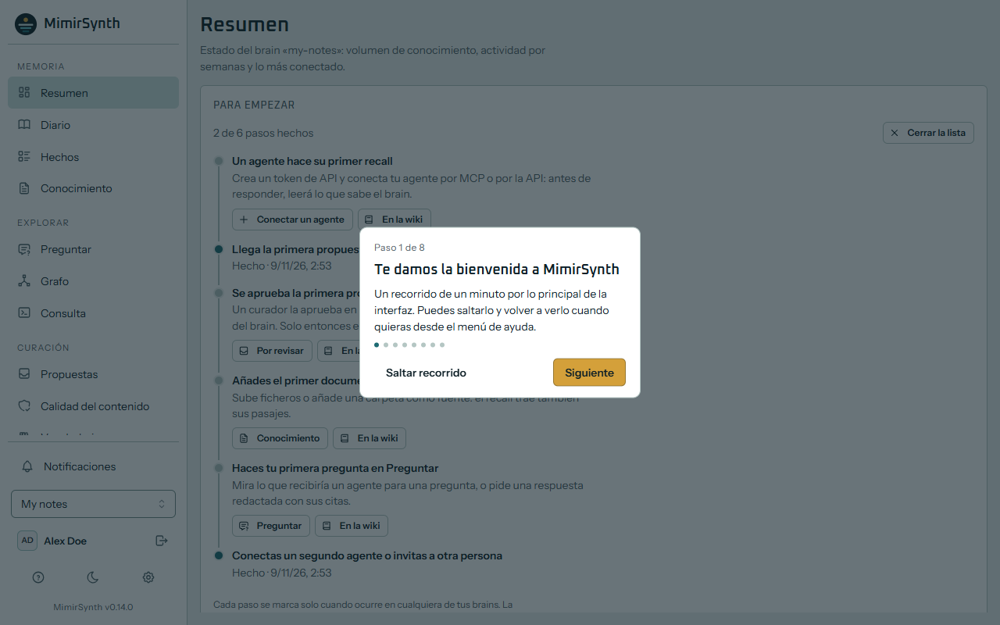
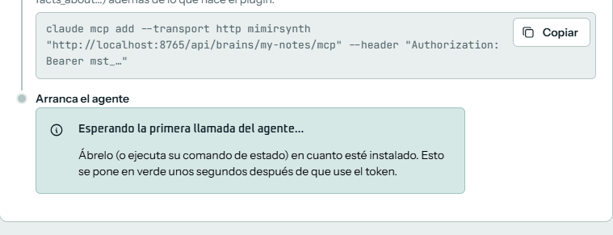
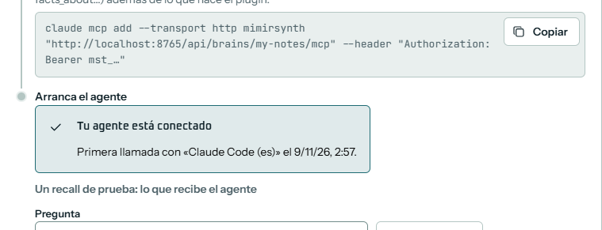
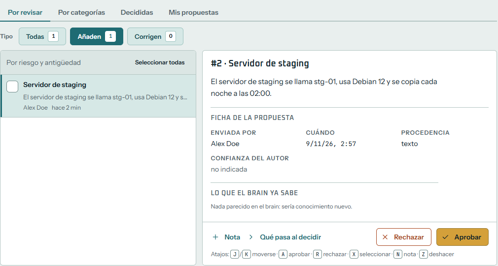
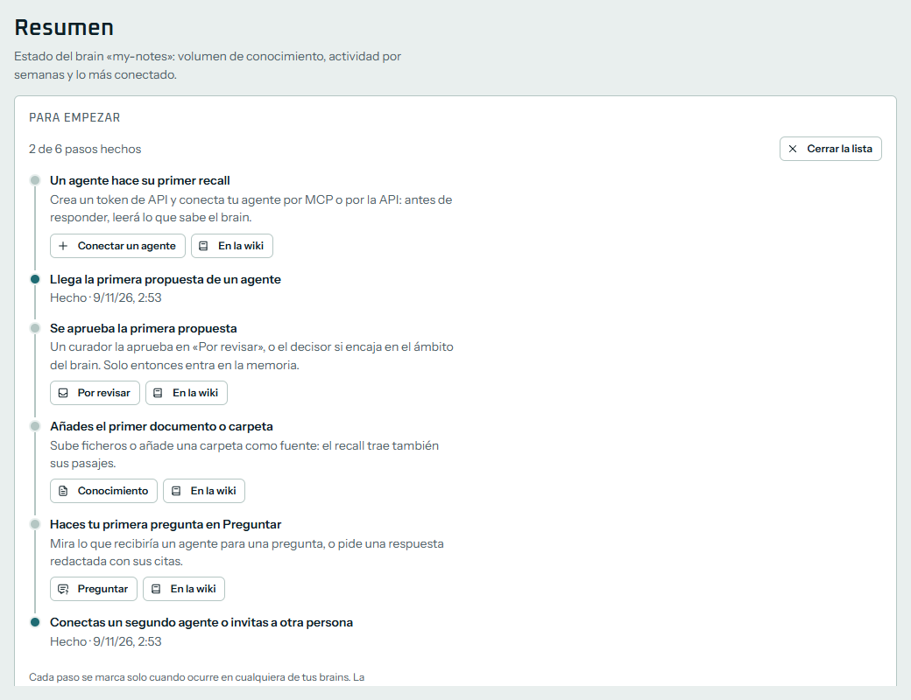

[English](Your-first-15-minutes) · **Español**

# Tus primeros 15 minutos

Esta guía es para ti si empiezas con agentes de IA y nunca has usado MimirSynth. Te lleva de un equipo vacío a un agente que recuerda lo que le enseñas: instalas MimirSynth, lo configuras, conectas tu agente, le enseñas una cosa, la apruebas y la recuperas. Son unos 15 minutos, más lo que tarden las descargas. No hace falta saber qué es Docker, MCP o un token: cada palabra se explica la primera vez que sale, y todas están en el [[Glosario]].

Si ya conoces Docker y solo quieres los comandos, ve a la [[Guía rápida]].

## Qué hace MimirSynth
Un **agente** de IA (Claude Code, Codex, OpenCode y similares) lo olvida todo al terminar una sesión. MimirSynth es una memoria que puede compartir contigo y con tus otros agentes: antes de responder, el agente pregunta a MimirSynth qué sabe del tema (un **recall**), y cuando aprende algo que merece la pena guardar, lo propone (un **remember**). La memoria se organiza como un **grafo de conocimiento**: cosas (personas, servidores, proyectos) y hechos con fecha entre ellas. Un hecho nunca se sobrescribe: cuando deja de ser cierto se marca así, de modo que la memoria sabe qué era cierto y cuándo.

Lo que propone un agente no entra directamente en la memoria. Espera en **cuarentena** hasta que una persona lo aprueba, o lo hace un modelo de IA de confianza (el **decisor**) cuando encaja con claridad. Así, un agente que se equivoca no ensucia la memoria. Todo esto se hace en una interfaz web, donde además puedes explorar el grafo, hacer preguntas y ver de dónde salió cada hecho. Cada memoria separada es un **brain**: uno para tu equipo, otro para un proyecto, otro para tus notas.

## Antes de empezar
- **Un equipo con Docker.** En Windows o macOS, instala [Docker Desktop](https://docs.docker.com/desktop/) y ábrelo una vez (en Windows necesita WSL2: `wsl --install` en un PowerShell abierto como administrador, y reinicia). En Linux el instalador se ofrece a instalar Docker por ti. Docker ejecuta MimirSynth y sus bases de datos en **contenedores**, pequeñas máquinas aisladas, así que no cambia nada más de tu equipo.
- **Unos 4 GB de memoria libre** y 6 GB de disco, más si los modelos de IA corren en el mismo equipo.
- **Un agente**: Claude Code, Codex, OpenCode, Hermes Agent, OpenClaw o cualquier otro cliente que hable MCP.
- **Dos modelos de IA**, a los que MimirSynth llama a través de cualquier servicio compatible con OpenAI:
  - un modelo de **embeddings**, que convierte los textos en números para poder buscar en la memoria por significado. El instalador puede arrancarte uno en tu equipo ([Ollama](https://ollama.com) con `nomic-embed-text`), gratis y sin cuenta;
  - un **LLM** (un modelo de lenguaje grande, como el que hay detrás de tu agente), que lee lo que se aprueba y extrae los hechos. Puede correr en tu equipo (un modelo *instruct* de unos 14B parámetros o más en Ollama, que necesita unos 10 GB de memoria) o venir de un proveedor (OpenAI, OpenRouter…) con una clave de API. Basta un modelo pequeño y barato con salida estructurada.

  Sin LLM, MimirSynth arranca y hace recall igual, pero no entra nada nuevo en la memoria.

## 1. Instala MimirSynth (unos 5 minutos)
Abre un terminal y pega una línea. En **Linux** o **macOS**:
```bash
curl -fsSL https://github.com/MimirSynth/mimirsynth/releases/latest/download/install.sh | bash
```
En **Windows**, en PowerShell, con Docker Desktop en marcha:
```powershell
irm https://github.com/MimirSynth/mimirsynth/releases/latest/download/install.ps1 | iex
```
El instalador comprueba Docker y hace dos preguntas. Si empiezas, quédate con la respuesta propuesta:
1. **Dónde vive tu grafo de conocimiento.** Elige **1) local**: arranca una base de datos de grafos (FalkorDB) junto a MimirSynth. *Existente* es para cuando ya tienes un FalkorDB o un Neo4j.
2. **Embeddings.** Si Ollama ya corre en tu equipo, el instalador lo usa y no pregunta. Si no, se ofrece a arrancar uno en un contenedor y descargar `nomic-embed-text`: responde **sí**, salvo que vayas a usar los embeddings de un proveedor. Es una descarga de unos 3,5 GB que funciona con el procesador.

Después genera las contraseñas, lo arranca todo (la primera vez descarga las imágenes: unos minutos) y espera a que MimirSynth responda. Al final escribe tres cosas y abre tu navegador:
- **Abre:** la dirección de MimirSynth, normalmente `http://localhost:8000`.
- **Código de inicio:** un código de un solo uso que demuestra que eres quien lo ha instalado. No cierres el terminal: lo necesitas en el paso siguiente.
- **Carpeta:** dónde se ha instalado (`~/mimirsynth`, o `%USERPROFILE%\mimirsynth` en Windows). Los comandos `docker compose` de esta wiki se ejecutan ahí.

<!-- captura: el final del instalador en un terminal, con Abre, Código de inicio y Carpeta -->

Si el instalador se detiene, dice por qué y no borra nada: corrige la causa y vuelve a ejecutar la misma línea. Ver [Si algo falla](#si-algo-falla). Más sobre el instalador, sus opciones y cómo comprobar la descarga: [[Instalación]].

## 2. Sigue el asistente de configuración (unos 5 minutos)
<!-- TODO(#361): esta sección está escrita a partir del alcance del asistente de configuración v2 (issue #361), no de las pantallas publicadas. Confirmar los nombres de los pasos, los preajustes y los botones, y añadir las capturas, cuando se fusione #361. -->
En el navegador, un asistente te guía por la configuración, un paso por pantalla. Puedes cerrar el navegador en cualquier momento: se vuelve a abrir en el paso donde lo dejaste. Algunos pasos prueban lo que has puesto y no te dejan seguir hasta que la prueba pasa, para que nunca acabes con una memoria que no puede funcionar.

1. **Cuenta de administrador.** Pega el código de inicio del terminal, y después tu nombre, tu correo y una contraseña (al menos 12 caracteres; el formulario marca cada regla mientras escribes). Esta cuenta administra toda la instalación.
   <!-- captura: asistente, cuenta de administrador -->
2. **Base de datos del grafo.** Dónde guardan los brains sus entidades y sus hechos. Si elegiste *local* en el instalador, muestra el FalkorDB incluido: pulsa **Probar la conexión**. Si tienes tu propio FalkorDB o Neo4j, pon su dirección y sus credenciales. No puedes seguir hasta que la prueba pasa. Si esa base de datos ya tiene grafos (de Graphiti, por ejemplo), el asistente se ofrece a adoptarlos como brains.
   <!-- captura: asistente, base de datos del grafo con la prueba pasada -->
3. **Embeddings.** Elige un preajuste:
   - **Ollama (local):** encuentra el Ollama de tu equipo, lista los modelos que tienes y se ofrece a descargar `nomic-embed-text` si falta. Con el Ollama que arrancó el instalador, la dirección es `http://ollama:11434/v1`.
   - **Compatible con OpenAI / OpenRouter:** la URL base (suele terminar en `/v1`), tu clave de API y el modelo.

   Pulsa **Probar**. No puedes seguir hasta que pasa. Elige este modelo con cuidado: cambiarlo después recalcula toda la memoria.
   <!-- captura: asistente, embeddings con el preajuste de Ollama -->
4. **LLM.** Los mismos preajustes, para el modelo que extrae los hechos. Pulsa **Probar**. Puedes saltarte este paso, pero hasta que lo configures un aviso en la pantalla de inicio te recuerda que las propuestas aprobadas no se convierten en memoria.
   <!-- captura: asistente, LLM -->
5. **Decisor** (opcional). Un modelo que aprueba por su cuenta lo que encaja con claridad en el brain y te pasa el resto; nunca rechaza. Sáltatelo la primera vez: aprobarás a mano en el paso 5 de esta guía.
6. **Primer brain.** Un nombre (por ejemplo «Mis notas») y un **slug**, el nombre corto que va en las direcciones (`mis-notas`). Si adoptaste un grafo en el paso 2, ya está ahí.
7. **Token.** El asistente crea un **token de API** para tu agente: una contraseña larga que empieza por `mst_` y permite a un agente usar un brain. Es un token de **colaborador**: el agente puede leer la memoria y proponer hechos nuevos, que esperan a que los apruebes. **Solo se muestra una vez**: cópialo ahora, o deja el asistente abierto para el paso siguiente.
   <!-- captura: asistente, token mostrado una vez -->
8. **Conecta tu agente.** El mismo panel que en la sección siguiente de esta guía.

Un administrador puede volver a abrir el asistente más tarde desde **Administración**. Con el primer brain creado, un **recorrido guiado** de ocho pasos enseña el menú, el selector de brain, las propuestas, el grafo, Preguntar y la administración. Escape o **Saltar recorrido** lo cierra; el **menú de ayuda** (la interrogación al pie de la barra lateral) lo vuelve a poner.



## 3. Conecta tu agente (unos 2 minutos)
Tu agente habla con MimirSynth por **MCP** (Model Context Protocol), la forma estándar de dar herramientas extra a un agente de IA: cada brain tiene su propio servidor MCP, y el token dice qué agente llama. El panel **Conectar un agente** lo escribe todo por ti. Es el último paso del asistente, y después está en **Administración → Brain → Conectar un agente**.
1. **¿Qué agente usas?** Elige el tuyo: Claude Code, Codex, OpenCode, Hermes Agent, OpenClaw u **Otro cliente MCP**.
2. **Token de API.** Usa el del asistente, o pulsa **Crear uno para este agente**. Deja **Colaborador: consulta y propone (recomendado)**. El secreto de un token solo se muestra al crearlo: con uno anterior, los fragmentos llevan `mst_…` donde va el tuyo.
3. **Copia lo que necesita.** Los fragmentos ya llevan este servidor, este brain y el token. Para un agente con plugin nativo de MimirSynth hay dos: **Guarda la configuración** (un fichero pequeño, `~/.config/mimirsynth/config.json`, que leen todos los plugins de MimirSynth; déjalo legible solo por ti, porque lleva el token) e **Instala el plugin** (una línea en un terminal; si pregunta la URL, el brain o el token, pulsa Intro para quedarte con lo que encontró en el fichero). Para cualquier otro cliente, **Añade el servidor a tu cliente** da el servidor MCP del brain en la forma `mcpServers` que leen la mayoría de clientes.
4. **Arranca el agente.** Ábrelo, o ejecuta su comando de estado. Unos segundos después de su primera llamada, el panel se pone en verde: **Tu agente está conectado**. Entonces hace un **recall de prueba**, para que veas lo que recibe el agente. En un brain nuevo todavía no encuentra nada, y es lo normal.





Cada agente tiene sus detalles (Codex, por ejemplo, pide confiar una vez en sus hooks): ver [[Conectar agentes]].

## 4. Enséñale algo
Pide a tu agente, en su chat, que recuerde un hecho concreto, con nombres exactos y fechas. Por ejemplo:

> Recuerda esto en MimirSynth: el servidor de staging se llama stg-01, usa Debian 12 y se copia cada noche a las 02:00.

El agente llama a la herramienta `remember`, y MimirSynth responde que la memoria queda en cuarentena hasta que un curador la apruebe, con el número de la propuesta. Como el token es de colaborador, el hecho **todavía no está en la memoria**: es una **propuesta** en cuarentena.

Escribe la memoria como se la contarías a un compañero: quién, qué, cuándo, con nombres exactos. Nunca pegues contraseñas ni claves: escribe dónde se guardan. MimirSynth busca secretos antes de guardar nada y los tapa. Más consejos en [[Escribir buena memoria]].

## 5. Aprueba la propuesta
En MimirSynth, abre **Propuestas**. La pestaña **Por revisar** lista lo que espera, lo más antiguo primero.
1. Abre la propuesta. A la derecha ves su texto, quién la envió (la persona dueña del token del agente), cuándo, y lo que el brain ya sabe que se le parece.
2. Si es correcta, pulsa **Aprobar** (o la tecla <kbd>A</kbd>). Si no, **Recházala**, con un motivo si quieres.
3. MimirSynth convierte ahora el texto en entidades y hechos (la **ingesta**). Tarda de unos segundos a un minuto, según tu LLM; puedes seguirla en **Trabajos**.



Cuando termina, abre **Hechos** o **Grafo**: verás `stg-01`, `Debian 12` y los hechos entre ellos. Cada hecho conserva el texto del que se aprendió. Todo sobre la revisión: [[Propuestas]].

## 6. Recupéralo
Abre una **sesión nueva** de tu agente (para que no se limite a recordar el chat) y pregunta:

> ¿Qué sistema operativo usa el servidor de staging?

El agente hace recall en MimirSynth y responde con lo que le enseñaste. Con un plugin nativo, el recall ocurre solo antes de cada mensaje; con MCP a secas, el agente llama a la herramienta `recall` cuando cree que necesita memoria, así que también puedes decirle «búscalo en MimirSynth».

Puedes ver lo mismo sin agente: en **Preguntar**, escribe la pregunta. Verás los hechos encontrados, los pasajes del texto original y el bloque exacto de contexto que recibiría un agente. Ver [[Preguntar]].

Ya está: tu agente tiene memoria. En la pantalla de inicio, la lista **Para empezar** se marca sola a medida que avanzas («Un agente hace su primer recall», «Llega la primera propuesta de un agente», «Se aprueba la primera propuesta»…) y sugiere lo siguiente: subir un documento, hacer tu primera pregunta en Preguntar, conectar un segundo agente o invitar a un compañero. Desaparece al completarla, o cuando la cierras.



## Si algo falla
| Lo que ves | Dónde mirar |
|---|---|
| El instalador dice que Docker no está instalado o no está en marcha | [Docker no está en marcha](Soluci%C3%B3n-de-problemas#docker-no-est%C3%A1-en-marcha) |
| La prueba de embeddings o del LLM falla con «conexión rechazada» o tiempo agotado, con Ollama | [El contenedor no llega a Ollama](Soluci%C3%B3n-de-problemas#el-contenedor-no-llega-a-ollama) |
| Falla la prueba de la base de datos del grafo | [Errores de conexión al grafo](Soluci%C3%B3n-de-problemas#errores-de-conexi%C3%B3n-al-grafo) |
| «el índice de texto es de 768 dimensiones y este modelo da …» | [La dimensión de los embeddings no coincide](Soluci%C3%B3n-de-problemas#la-dimensi%C3%B3n-de-los-embeddings-no-coincide) |
| El panel nunca se pone en verde | [Agentes](Soluci%C3%B3n-de-problemas#agentes): casi siempre un token o una dirección mal puestos en la configuración del agente |
| La propuesta está aprobada pero no aparecen hechos | No hay LLM configurado, o el modelo es demasiado pequeño: [Memoria](Soluci%C3%B3n-de-problemas#memoria) |

¿Sigues atascado? Abre una [issue](https://github.com/MimirSynth/mimirsynth/issues) con lo que hiciste y lo que viste (sin tokens ni contraseñas).

## Y después
- Entiende las ideas de fondo: [[Conceptos]].
- Dale documentos y carpetas: [[Conocimiento]].
- Invita a tu equipo y da a cada persona su rol: [[Administrar usuarios]], [[Roles y permisos]].
- Antes de abrirlo a otros equipos o a Internet, ponlo detrás de HTTPS: [[HTTPS y proxy inverso]].
- Mantenlo al día y con copias: [[Actualización y copias de seguridad]].
