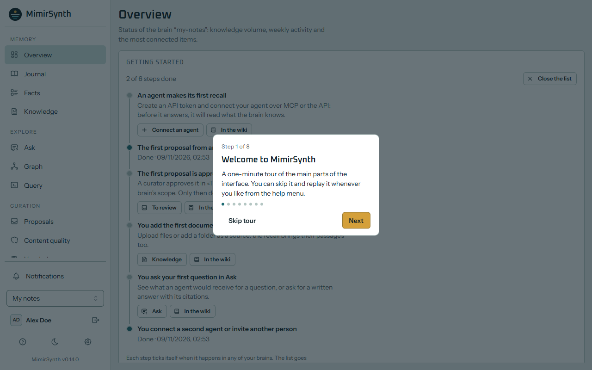
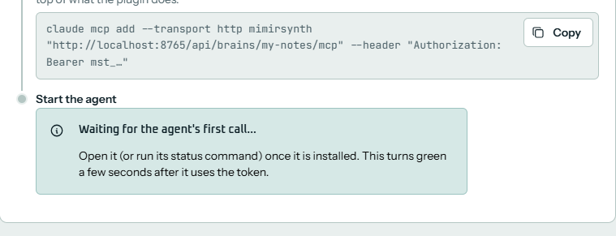
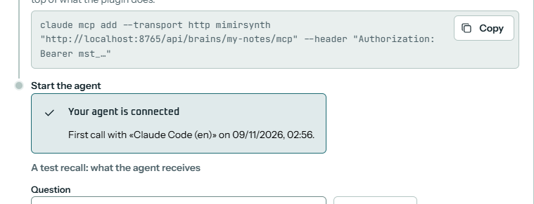
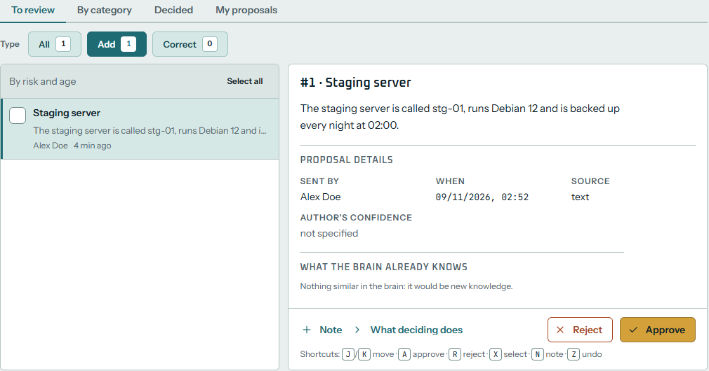
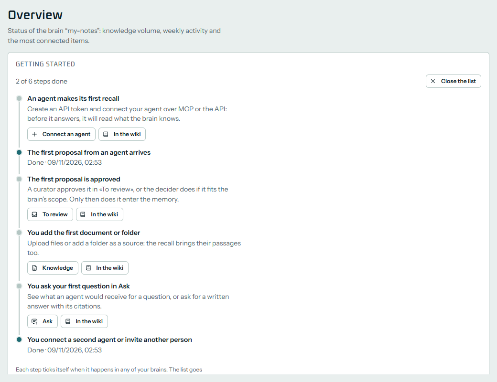

**English** · [Español](Tus-primeros-15-minutos)

# Your first 15 minutes

This guide is for you if you are starting with AI agents and have never used MimirSynth. It takes you from an empty computer to an agent that remembers what you teach it: you install MimirSynth, set it up, connect your agent, teach it one thing, approve it and get it back. It takes about 15 minutes, plus the downloads. You do not need to know Docker, MCP or what a token is: each word is explained when it first appears, and all of them are in the [[Glossary]].

If you already know Docker and only want the commands, go to [[Quick start]].

## What MimirSynth does
An AI **agent** (Claude Code, Codex, OpenCode and the like) forgets everything when a session ends. MimirSynth is a memory it can share with you and with your other agents: before it answers, the agent asks MimirSynth what it knows about the subject (a **recall**), and when it learns something worth keeping, it proposes it (a **remember**). The memory is organised as a **knowledge graph**: things (people, servers, projects) and dated facts between them. A fact is never overwritten: when it stops being true it is marked as such, so the memory knows what was true and when.

What an agent proposes does not go straight into the memory. It waits in **quarantine** until a person approves it, or an AI model you trust (the **decider**) does when it clearly fits. That way an agent that gets something wrong does not pollute the memory. You do all of this in a web interface, where you can also explore the graph, ask questions and see where each fact came from. Each separate memory is a **brain**: one for your team, one for a project, one for your notes.

## Before you start
- **A computer with Docker.** On Windows or macOS, install [Docker Desktop](https://docs.docker.com/desktop/) and open it once (on Windows it needs WSL2: `wsl --install` in a PowerShell opened as administrator, then restart). On Linux the installer offers to install Docker for you. Docker runs MimirSynth and its databases in **containers**, small isolated machines, so nothing else on your computer changes.
- **About 4 GB of free memory** and 6 GB of disk, more if you run the AI models on the same computer.
- **An agent**: Claude Code, Codex, OpenCode, Hermes Agent, OpenClaw or any other client that speaks MCP.
- **Two AI models**, which MimirSynth calls through any OpenAI-compatible service:
  - an **embedding** model, which turns texts into numbers so the memory can be searched by meaning. The installer can start one for you on your computer ([Ollama](https://ollama.com) with `nomic-embed-text`), free and without an account;
  - an **LLM** (a large language model, like the one behind your agent), which reads what is approved and extracts the facts. It can run on your computer (an *instruct* model of about 14B parameters or more on Ollama, which needs about 10 GB of memory) or come from a provider (OpenAI, OpenRouter…) with an API key. A small, cheap model with structured output is enough.

  Without an LLM, MimirSynth still starts and recalls, but nothing new enters the memory.

## 1. Install MimirSynth (about 5 minutes)
Open a terminal and paste one line. On **Linux** or **macOS**:
```bash
curl -fsSL https://github.com/MimirSynth/mimirsynth/releases/latest/download/install.sh | bash
```
On **Windows**, in PowerShell, with Docker Desktop running:
```powershell
irm https://github.com/MimirSynth/mimirsynth/releases/latest/download/install.ps1 | iex
```
The installer checks Docker and asks two questions. If you are starting, take the suggested answer:
1. **Where your knowledge graph lives.** Choose **1) local**: it starts a graph database (FalkorDB) next to MimirSynth. *Existing* is for when you already run FalkorDB or Neo4j.
2. **Embeddings.** If Ollama already runs on your computer, the installer uses it and does not ask. Otherwise it offers to start one in a container and download `nomic-embed-text`: answer **yes** unless you will use a provider's embeddings. It is a download of about 3.5 GB that runs on the processor.

It then generates the passwords, starts everything (the first time it downloads the images, a few minutes) and waits until MimirSynth answers. At the end it prints three things and opens your browser:
- **Open:** the address of MimirSynth, usually `http://localhost:8000`.
- **First-start code:** a one-time code that proves you are the person who installed it. Keep the terminal open: you need it in the next step.
- **Folder:** where it was installed (`~/mimirsynth`, or `%USERPROFILE%\mimirsynth` on Windows). The `docker compose` commands of this wiki run there.

<!-- screenshot: the end of the installer in a terminal, with Open, First-start code and Folder -->

If the installer stops, it says why and removes nothing: fix the cause and run the same line again. See [If something goes wrong](#if-something-goes-wrong). More about the installer, its options and how to check the download: [[Installation]].

## 2. Follow the setup wizard (about 5 minutes)
<!-- TODO(#361): this section is written from the scope of the setup wizard v2 (issue #361), not from the shipped screens. Confirm the step names, the presets and the buttons, and add the screenshots, when #361 is merged. -->
In the browser, a wizard walks you through the setup, one step per screen. You can close the browser at any moment: it reopens on the step where you stopped. Some steps test what you entered and do not let you go on until the test passes, so that you never end up with a memory that cannot work.

1. **Administrator account.** Paste the first-start code from the terminal, then your name, email and a password (at least 12 characters; the form ticks each rule as you type). This account administers the whole installation.
   <!-- screenshot: wizard, administrator account -->
2. **Graph database.** Where the brains keep their entities and facts. If you chose *local* in the installer, it shows the bundled FalkorDB: press **Test the connection**. If you run your own FalkorDB or Neo4j, enter its address and credentials. You cannot go on until the test passes. If that database already holds graphs (from Graphiti, for example), the wizard offers to adopt them as brains.
   <!-- screenshot: wizard, graph database with a passed test -->
3. **Embeddings.** Choose a preset:
   - **Ollama (local):** it finds Ollama on your computer, lists the models you have and offers to download `nomic-embed-text` if it is missing. With the Ollama the installer started, the address is `http://ollama:11434/v1`.
   - **OpenAI-compatible / OpenRouter:** the base URL (usually ending in `/v1`), your API key and the model.

   Press **Test**. You cannot go on until it passes. Choose this model with care: changing it later recomputes the whole memory.
   <!-- screenshot: wizard, embeddings with the Ollama preset -->
4. **LLM.** The same presets, for the model that extracts the facts. Press **Test**. You can skip this step, but until you configure it a warning on the home screen reminds you that approved proposals are not turned into memory.
   <!-- screenshot: wizard, LLM -->
5. **Decider** (optional). A model that approves on its own what clearly fits the brain and sends the rest to you; it never rejects. Skip it the first time: you will approve by hand in step 5 of this guide.
6. **First brain.** A name (for example «My notes») and a **slug**, the short name that goes in addresses (`my-notes`). If you adopted a graph in step 2, it is already there.
7. **Token.** The wizard creates an **API token** for your agent: a long password that starts with `mst_`, that lets one agent use one brain. It is a **contributor** token: the agent can read the memory and propose new facts, which wait for your approval. **It is shown only once**: copy it now, or leave the wizard open for the next step.
   <!-- screenshot: wizard, token shown once -->
8. **Connect your agent.** The same panel as in the next section of this guide.

An administrator can reopen the wizard later from **Administration**. With the first brain in place, a **guided tour** of eight steps shows the menu, the brain switcher, proposals, the graph, Ask and administration. Escape or **Skip tour** closes it; the **help menu** (the question mark at the bottom of the sidebar) plays it again.



## 3. Connect your agent (about 2 minutes)
Your agent talks to MimirSynth through **MCP** (Model Context Protocol), the standard way to give an AI agent extra tools: each brain has its own MCP server, and the token says which agent is calling. The **Connect an agent** panel writes everything for you. It is the last step of the wizard, and later it is under **Administration → Brain → Connect an agent**.
1. **Which agent do you use?** Choose yours: Claude Code, Codex, OpenCode, Hermes Agent, OpenClaw, or **Other MCP client**.
2. **API token.** Use the one from the wizard, or press **Create one for this agent**. Keep **Contributor: recalls and proposes (recommended)**. A token's secret is shown only when it is created: with an older one, the snippets carry `mst_…` where yours goes.
3. **Copy what it needs.** The snippets already carry this server, this brain and the token. For an agent with a native MimirSynth plugin, there are two: **Save the configuration** (a small file, `~/.config/mimirsynth/config.json`, that every MimirSynth plugin reads; keep it readable only by you, it holds the token) and **Install the plugin** (one line in a terminal; if it asks for the URL, the brain or the token, press Enter to keep what it found in the file). For any other client, **Add the server to your client** gives the brain's MCP server in the `mcpServers` form most clients read.
4. **Start the agent.** Open it, or run its status command. A few seconds after its first call, the panel turns green: **Your agent is connected**. It then runs a **test recall**, so you see what the agent receives. In a new brain it finds nothing yet, and that is normal.





Each agent has its own details (Codex, for example, asks you to trust its hooks once): see [[Connect agents]].

## 4. Teach it something
Ask your agent, in its chat, to remember a concrete fact, with exact names and dates. For example:

> Remember this in MimirSynth: the staging server is called stg-01, runs Debian 12 and is backed up every night at 02:00.

The agent calls the `remember` tool, and MimirSynth answers that the memory stays in quarantine until a curator approves it, with the proposal's number. Because the token is a contributor, the fact is **not in the memory yet**: it is a **proposal** in quarantine.

Write memory as you would tell a colleague: who, what, when, with exact names. Never paste passwords or keys: write where they are kept instead. MimirSynth looks for secrets before it stores anything and masks them. More advice in [[Writing good memory]].

## 5. Approve the proposal
In MimirSynth, open **Proposals**. The **To review** tab lists what is waiting, the oldest first.
1. Open the proposal. On the right you see its text, who sent it (the person who owns the agent's token), when, and what the brain already knows that is close to it.
2. If it is correct, press **Approve** (or the <kbd>A</kbd> key). If not, **Reject** it, with a reason if you like.
3. MimirSynth now turns the text into entities and facts (**ingestion**). It takes a few seconds to a minute, depending on your LLM; you can follow it under **Jobs**.



When it finishes, open **Facts** or **Graph**: you will see `stg-01`, `Debian 12` and the facts between them. Each fact keeps the text it was learned from. All about reviewing: [[Proposals]].

## 6. Get it back
Start a **new session** of your agent (so it does not simply remember the chat) and ask:

> Which operating system does the staging server run?

The agent recalls from MimirSynth and answers with what you taught it. With a native plugin the recall happens on its own before every message; with plain MCP the agent calls the `recall` tool when it thinks it needs memory, so you can also say «look it up in MimirSynth».

You can see the same thing without an agent: in **Ask**, write the question. You see the facts found, the passages of the original text and the exact block of context an agent would receive. See [[Ask]].

That is it: your agent now has a memory. On the home screen, the **Getting started** list ticks itself as you go («An agent makes its first recall», «The first proposal from an agent arrives», «The first proposal is approved»…) and suggests what comes next: upload a document, ask your first question in Ask, connect a second agent or invite a colleague. It goes away once it is complete, or when you close it.



## If something goes wrong
| What you see | Where to look |
|---|---|
| The installer says Docker is not installed or not running | [Docker is not running](Troubleshooting#docker-is-not-running) |
| The embeddings or LLM test fails with «connection refused» or a timeout, with Ollama | [Ollama is not reachable from the container](Troubleshooting#ollama-is-not-reachable-from-the-container) |
| The graph database test fails | [Graph connection errors](Troubleshooting#graph-connection-errors) |
| «the text index has 768 dimensions and this model gives …» | [Embedding dimension mismatch](Troubleshooting#embedding-dimension-mismatch) |
| The panel never turns green | [Agents](Troubleshooting#agents): usually a wrong token or address in the agent's configuration |
| The proposal is approved but no facts appear | No LLM configured, or a model that is too small: [Memory](Troubleshooting#memory) |

Still stuck? Open an [issue](https://github.com/MimirSynth/mimirsynth/issues) with what you did and what you saw (without tokens or passwords).

## Where next
- Understand the ideas behind it: [[Concepts]].
- Give it documents and folders: [[Knowledge]].
- Invite your team and give each person a role: [[Administer users]], [[Roles and permissions]].
- Before you open it to other computers or the Internet, put it behind HTTPS: [[HTTPS and reverse proxy]].
- Keep it up to date and backed up: [[Upgrade and backups]].
